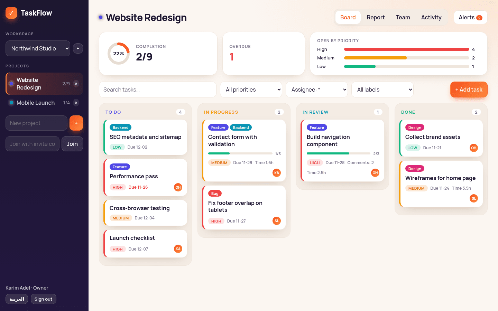
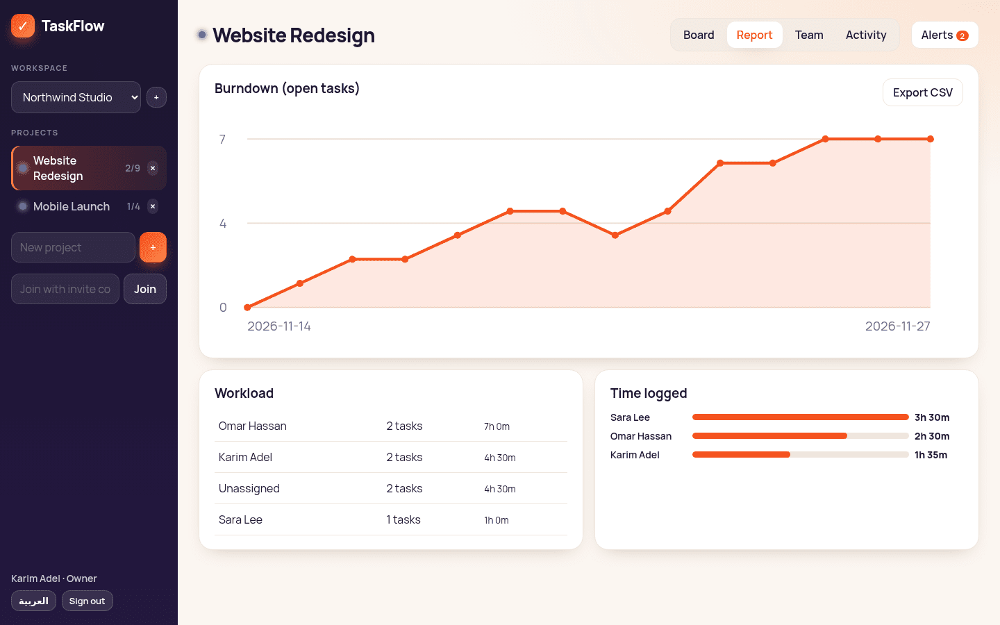
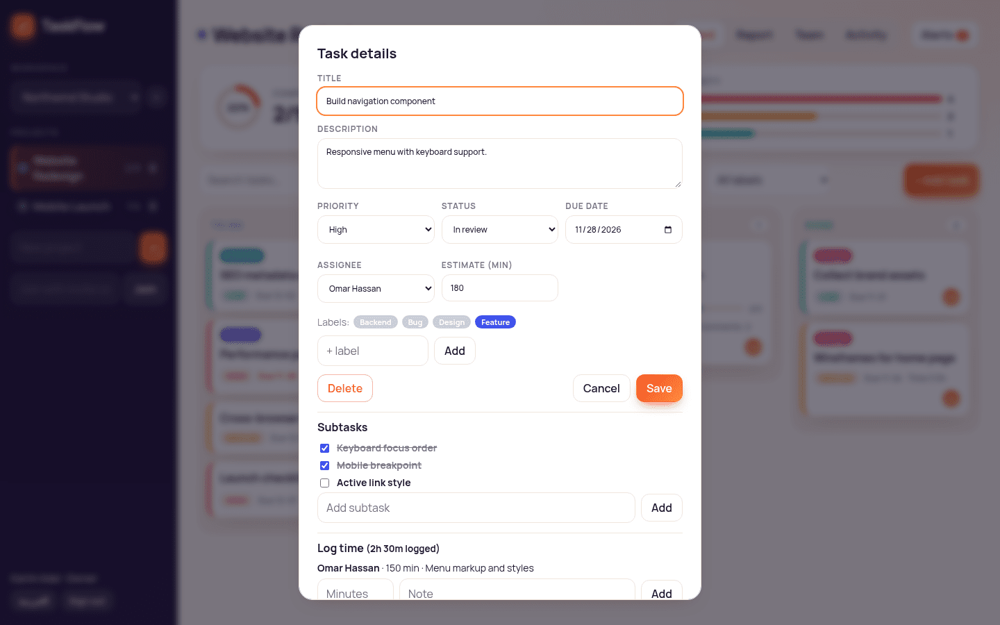

# TaskFlow





A team project board. Express and SQLite on the server, React on the client. Workspaces with roles, kanban boards with drag and drop, assignees, labels, subtasks, time tracking, comments with @mentions, notifications, an activity feed, reports with a burndown chart, CSV export, and an English/Arabic interface with full right-to-left layout.

This is a portfolio project, not client work.

## Features
- Accounts with salted scrypt password hashes and signed, expiring tokens. Login and register are rate limited.
- Workspaces with four roles (owner, admin, member, viewer), invite codes that only the invited email can accept, and role rules enforced on every endpoint.
- Projects and a four-column board. Drag a card between or within columns. Ordering uses fractional positions so a move touches one row.
- Task detail: description, priority, due date, assignee, estimate, labels, subtasks with progress, time entries, comments.
- `@name` mentions and assignments create notifications. Self-actions do not.
- Activity feed per workspace.
- Report page: burndown of open tasks, workload by person, time logged by person. Export a project to CSV (formula injection is neutralised).
- Arabic and English, with `dir` switching.

## Run it
Needs Node 22 or newer.

```bash
npm install
npm run build
SEED_DEMO=1 npm start     # http://localhost:3000, sample login: karim@northwind.test / welcome123
```

Development with hot reload: `npm run dev:server` and in another terminal `npm run dev:client`.

Environment: `PORT`, `DB_FILE` (default `taskflow.db`), `TOKEN_SECRET` (set this in production), `SEED_DEMO=1` to fill an empty database with sample data.

Docker: `docker build -t taskflow . && docker run -p 3000:3000 -e TOKEN_SECRET=change-me -v taskflow:/data taskflow`

## Tests
```bash
npm test
```
17 tests cover authentication, validation, rate limiting, task lifecycle, filters, assignments and notifications, labels, subtasks, time tracking, mentions, reports, CSV export, and a role and isolation matrix (outsiders get 404, each role gets exactly its permissions).

## API
See [docs/API.md](docs/API.md).

## Structure
```
server/   app.js (routes), auth.js, db.js (schema), http.js (validation, rate limit), seed.js
client/   React app (Vite): Board, TaskModal, Report, Team, Activity, Bell
test/     node:test suites
```

## Known limits
SQLite and the in-memory rate limiter fit a single process. Invite codes are shown in the Team page instead of emailed. No file attachments.
